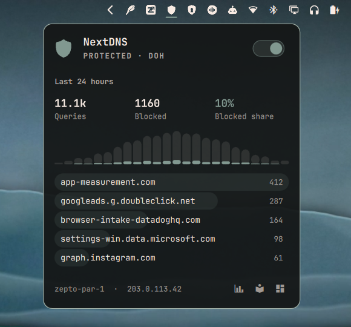

# NextDNS for Omarchy

See at a glance whether your DNS is really going through
[NextDNS](https://nextdns.io), and what it blocked today, from the
[Omarchy](https://omarchy.org) bar.



- **Bar icon**: the NextDNS logo when you're protected. A `!` is cut out of it
  when lookups go out unencrypted, and it turns red when DNS bypasses NextDNS
  or can't reach it. An outline with a slash means the service is stopped.
- **Switch** to start or stop the `nextdns` service.
- **Last 24 hours**: queries, blocked count and share, an hourly chart (hover a
  bar for that hour) and your most blocked domains.
- **Footer**: the NextDNS server you're using, your public IP, and links to the
  dashboard's analytics, logs and setup pages.

Works with Omarchy 4 (the Quickshell-based shell). English and French.

## Requirements

- The [NextDNS CLI](https://github.com/nextdns/nextdns/wiki), installed and
  configured with a profile (`sh -c "$(curl -sL https://nextdns.io/install)"`)
- `python3` and `pkexec`, which ship with Omarchy

## Install

```sh
omarchy plugin add https://github.com/cempack/omarchy-nextdns.git --enable
```

That clones the plugin and puts its icon in the bar. Click it to open the panel.

### Stats (optional)

The panel asks for a NextDNS API key to show the last 24 hours. Copy yours from
the bottom of [my.nextdns.io/account](https://my.nextdns.io/account), paste it
into the panel and press **Enter**. It is saved to `~/.config/nextdns/api-key`,
readable only by you.

Don't want stats? Click **Not now**. The eye button in the footer brings them back.

## Use it

**Bar icon**: left-click opens the panel, right-click refreshes, middle-click
opens the NextDNS dashboard.

**Panel keys**: `s` start/stop the service · `r` refresh · `d` dashboard ·
`l` query logs · `a` analytics · `k` account page (for the API key) · `Esc` close.

Starting or stopping the service asks for your password through Omarchy's
authentication prompt (`pkexec nextdns start|stop`). Nothing else needs root.

## What it talks to

- **The `nextdns` CLI**: only `nextdns status` and `nextdns config`, which work
  without root. (Commands such as `cache-stats` re-run themselves through
  `sudo`, which would keep waking a fingerprint reader, so they are not used.)
- **https://test.nextdns.io**: tells whether lookups really reach NextDNS, and
  over which protocol. Called when the panel opens, on refresh, and about every
  5 minutes. Turn off **Verify via test.nextdns.io** to stop it.
- **https://api.nextdns.io**: only if you saved an API key, only while the
  panel is open, and at most once a minute. Three read-only analytics requests
  for your profile.

## Settings

Change them with `omarchy bar set io.github.cempack.nextdns <key> <value> --json`:

| Key | Default | |
|---|---|---|
| `cliPath` | `nextdns` | Command used to reach the daemon |
| `refreshIntervalSec` | `30` | How often the local status is read |
| `checkConnection` | `true` | Verify via test.nextdns.io |
| `showStats` | `true` | Show the last 24 hours in the panel |
| `apiKeyFile` | `~/.config/nextdns/api-key` | Where the API key is stored |

## Remove

```sh
omarchy plugin remove io.github.cempack.nextdns
rm -f ~/.config/nextdns/api-key   # if you saved an API key
```

## Credits

Not affiliated with NextDNS. The NextDNS logo comes from
[Simple Icons](https://simpleicons.org) (CC0); NextDNS is a trademark of NextDNS Inc.

## License

[MIT](LICENSE)
